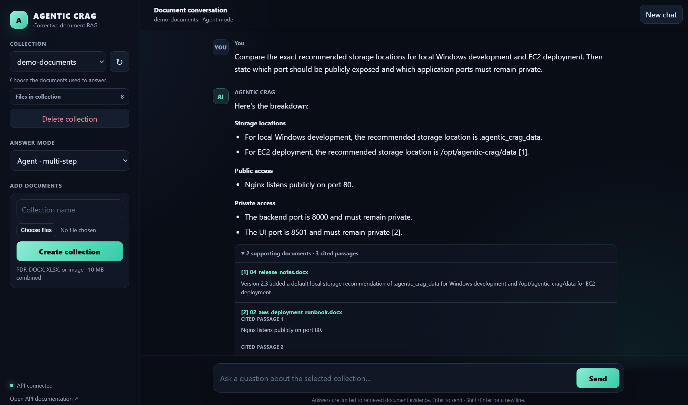
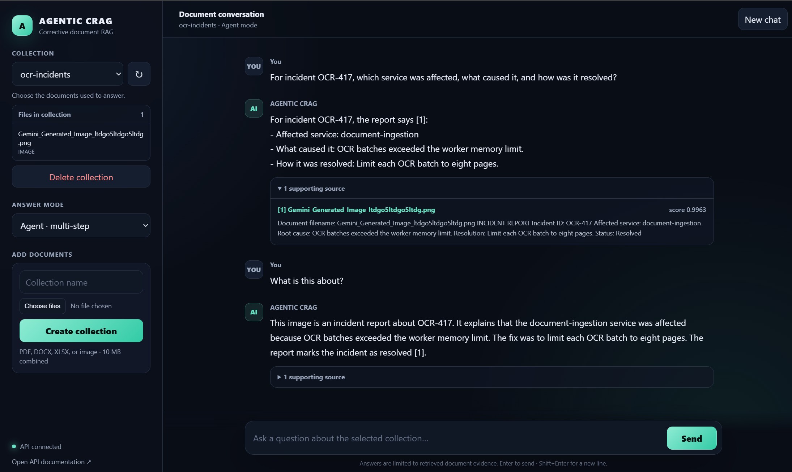

# Agentic CRAG

[](https://github.com/faisalcn24/agentic-crag/actions/workflows/ci.yml)

Local-first document question answering with citations, OCR, hybrid search,
persistent Chroma vector storage, and one bounded corrective retrieval pass.

Agentic CRAG turns PDF, DOCX, XLSX, and image files into persistent collections
that can be queried through a browser, REST API, or MCP server. Parsing,
embeddings, retrieval, and storage remain local. Generation uses local Ollama by
default. Groq is an explicit hosted option that receives only the question and
retrieved excerpts.

## Interface



*Structured answers grounded in cited document passages.*



*Local OCR turns uploaded images into searchable, cited evidence.*

## What stands out

- **Grounded, inspectable answers:** unsupported claims are removed, missing
  answers abstain, and completed answers show only cited, verified passages grouped
  by document.
- **Structured multi-part answers:** verified claims are organized under semantic
  headings with one claim per bullet and citations attached to the relevant group.
- **Hybrid retrieval:** BM25 and vector results are fused and reranked, improving
  both semantic search and exact-identifier lookup.
- **Bounded correction:** multi-part questions are decomposed, checked against
  exact source quotes, and receive at most one corrective retrieval per missing
  part—never an open-ended agent loop.
- **Document support:** local OCR handles images and scanned PDFs; openpyxl turns
  each nonempty XLSX row into a labeled node with workbook, sheet, and row provenance.
- **Three interfaces:** a dependency-free web UI, FastAPI endpoints, and MCP tools
  for Claude Code or another compatible host.

**Stack:** Python 3.13, FastAPI, LlamaIndex, ChromaDB, BM25, BGE
embeddings/reranking, RapidOCR, openpyxl, Ollama, optional Groq, MCP, pytest, and
Ruff.

## Architecture

```text
documents -> parse / OCR -> chunk -> persistent Chroma vector index
                                      |
question -> BM25 + vector -> fusion -> rerank -> grounded answer
                                      |
                     multi-part -> quote coverage check
                                      |
                         one correction -> answer or abstain
```

## Run locally

Install [Python 3.13](https://www.python.org/) and
[Ollama](https://ollama.com/), then:

```powershell
py -3.13 -m venv venv
venv\Scripts\Activate.ps1
python -m pip install -r requirements.txt
Copy-Item .env.example .env
ollama pull llama3.2:3b
.\run.bat
```

Keep Ollama running while asking questions. Hugging Face model loading is
cache-only during normal operation. If the BGE embedding and reranker models are
not cached yet, set `$env:HF_HUB_OFFLINE = "0"` and
`$env:TRANSFORMERS_OFFLINE = "0"` for the first indexing and retrieval session,
then remove those overrides.

Open `http://localhost:8000`, create a collection, and upload files from
`documents/`. API documentation is at `http://localhost:8000/docs`. The default
development configuration stores uploads, indexes, the collection registry, and
query metrics under `.agentic_crag_data/`.

Try:

- `What does FR-006 require?`
- `What is the projected Q3 Groq API budget?`
- `Contrast the recommended local Windows and EC2 storage locations.`
- `What was the company payroll for 2026?` (demonstrates abstention)

Run the MCP server with `python -m functions.mcp_server`. It exposes the
`collections://all` resource plus `search_corpus` and `answer_question` tools over
stdio by default.

## Deploy to EC2

Use `/opt/agentic-crag/data` for persistent application data. Expose only Nginx on
port 80; keep FastAPI port 8000 and Ollama port 11434 bound to localhost. The
bundled browser UI is served by FastAPI and does not require a separate frontend
port. See the [deployment guide](docs/DEPLOYMENT.md) for setup and update commands.

## Verification

```powershell
python -m pip install -r requirements-dev.txt
python -m pytest -q
ruff check functions tests evals scripts
python -m compileall -q functions tests evals scripts
python -m pip check
```

The current generalized runtime passes **189 default tests with 2 optional live
checks skipped**. Set `AGENTIC_CRAG_RUN_LIVE_QUALITY_TESTS=1` to opt into the real
reranker and Ollama checks.

The current [Phase 0 evaluation](docs/EVALUATION.md) contains an independently
graded 240-trial corrective-ON run for the selected `llama3.2:3b` model at
temperature 0. Across the 150 answerable trials, it achieved a 96.0% answer rate,
83.3% conditional correctness, and 80.0% strict correctness. Multi-hop conditional
and strict correctness were both 66.7%.

The model does not yet pass the release contract: aggregate conditional
correctness is below 85%, and multi-hop conditional correctness is below 75%.
Returned answers achieved 100% faithfulness and citation accuracy, with zero
deadline fallbacks. Mean latency was 7.80 seconds and P95 latency was 12.39
seconds. The report keeps answer rate, conditional correctness, and strict
correctness together, plus separate false-abstention and deadline-fallback rates.

## Boundaries

This is a trusted local demo, not a public multi-tenant service. Add
authentication, HTTPS, rate limiting, and a retention policy before accepting
private uploads through a public endpoint. OCR is tested on printed text, not
handwriting or arbitrary layouts. XLSX sheets support retrieval and grounded row
lookups, not guaranteed full-sheet aggregation or database-style analytics.

See [engineering decisions](docs/DECISIONS.md),
[evaluation methodology](docs/EVALUATION.md), and
[deployment notes](docs/DEPLOYMENT.md).
